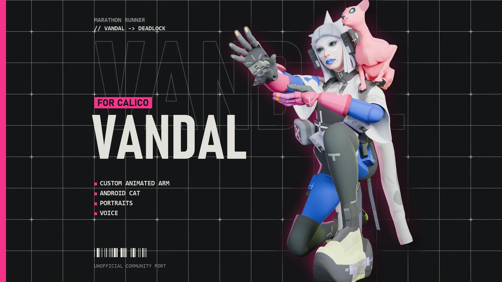
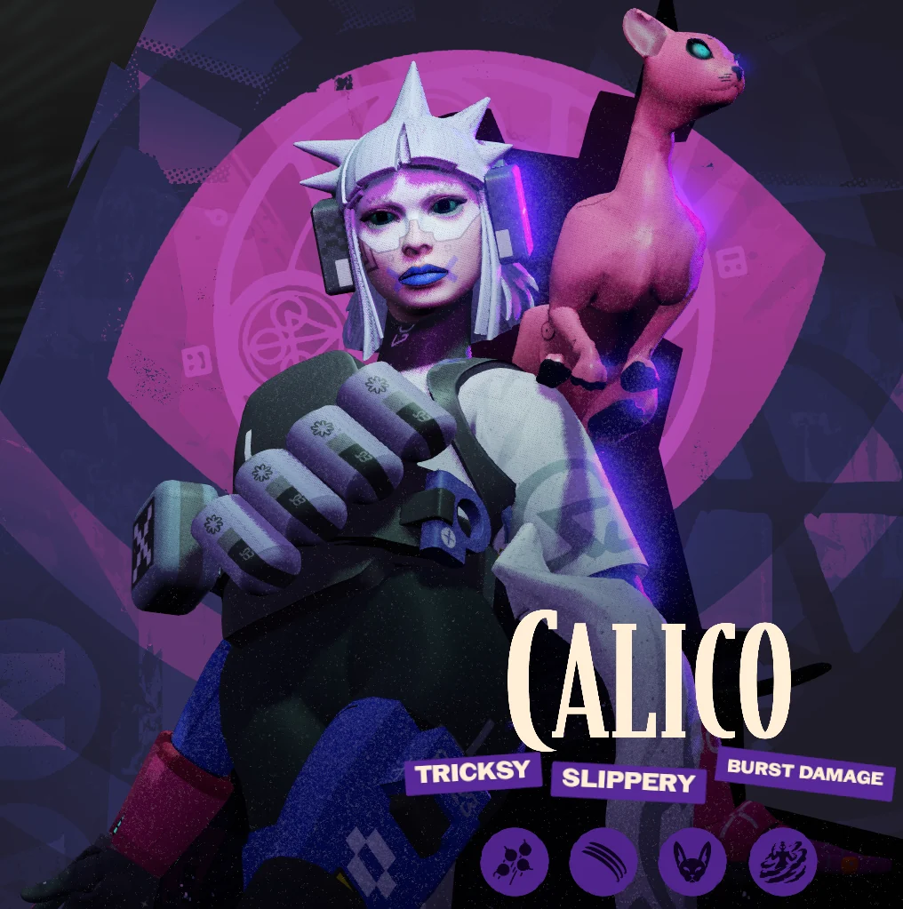
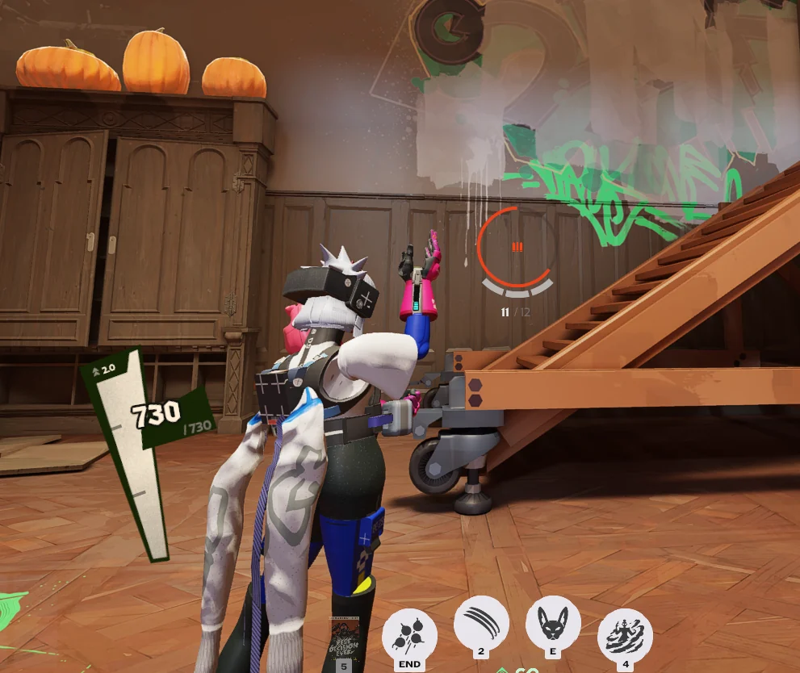
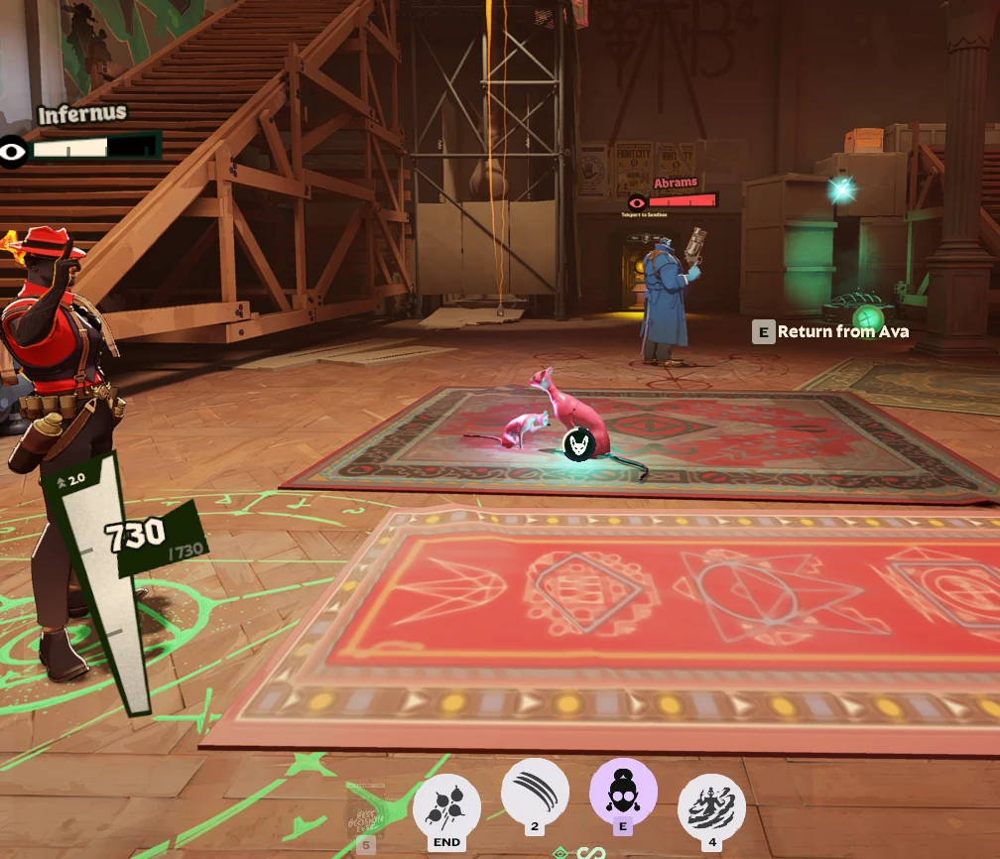

# Marathon Vandal for Calico

Turns Calico into Vandal, the Marathon runner, with her arm cannon, Bingus the android cat, portraits and voice.

## Downloads
- **[Default](https://github.com/Vyrena/marathon-vandal-calico/releases/latest/download/Vandal_Calico.zip)**: Her standard Marathon outfit, with blue lips and a pink arm cannon.
- **[Null Tempest](https://github.com/Vyrena/marathon-vandal-calico/releases/latest/download/Vandal_NullTempest_Calico.zip)**: Her PlayStation promo outfit in grey and blue, with a face mask and a blue arm cannon.

Each look is its own mod. Enable only one. **[Install guide](https://vyrena.github.io/marathon-vandal-calico/)**

## Install
1. Download the zip. Keep it zipped.
2. In [Deadlock Mod Manager](https://deadlockmods.app/), click **Add Local Mod**, drop the zip in and click **Add**.
3. In **Mods Library**, click **Enable**, then start the game with **Launch modded**.

Manual install, updating and troubleshooting: https://vyrena.github.io/marathon-vandal-calico/

## In game

## Credits
Made by Vyrena, with heavy AI assistance. Unofficial community port. Marathon, its characters and assets belong to Bungie. Deadlock belongs to Valve. Not affiliated with or endorsed by either.
